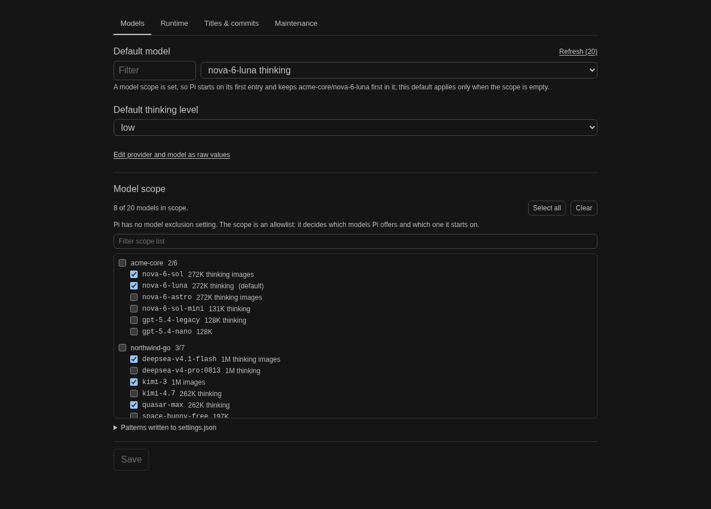
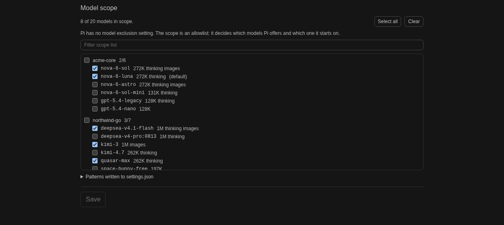
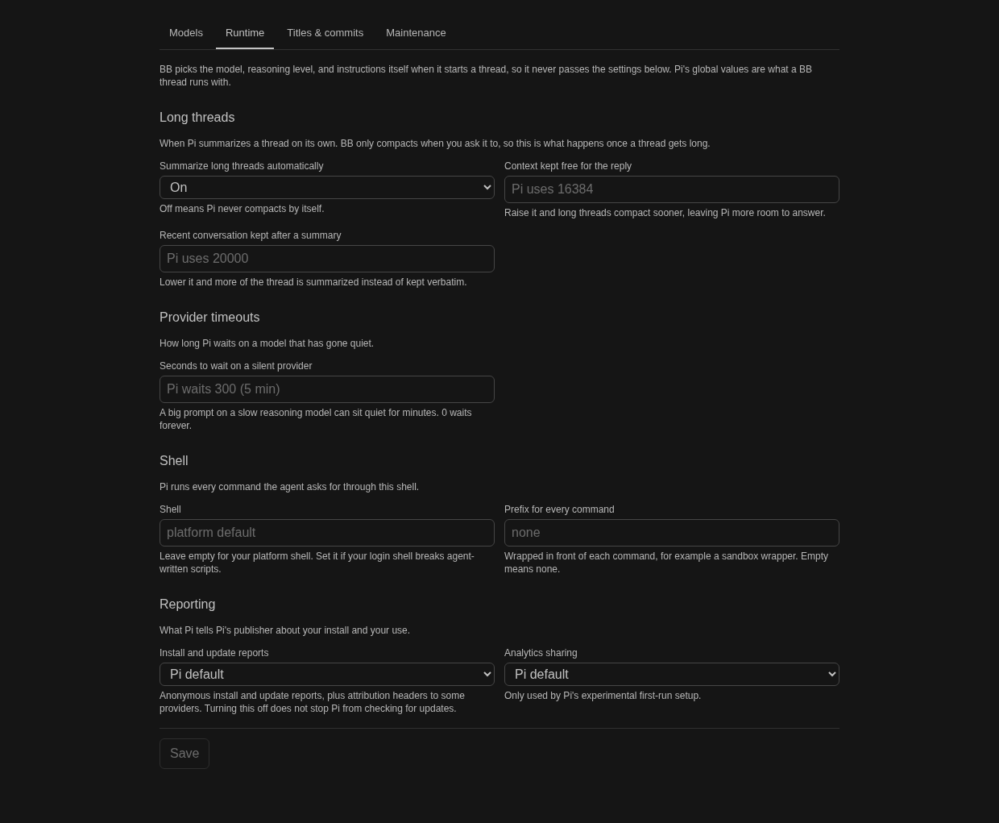
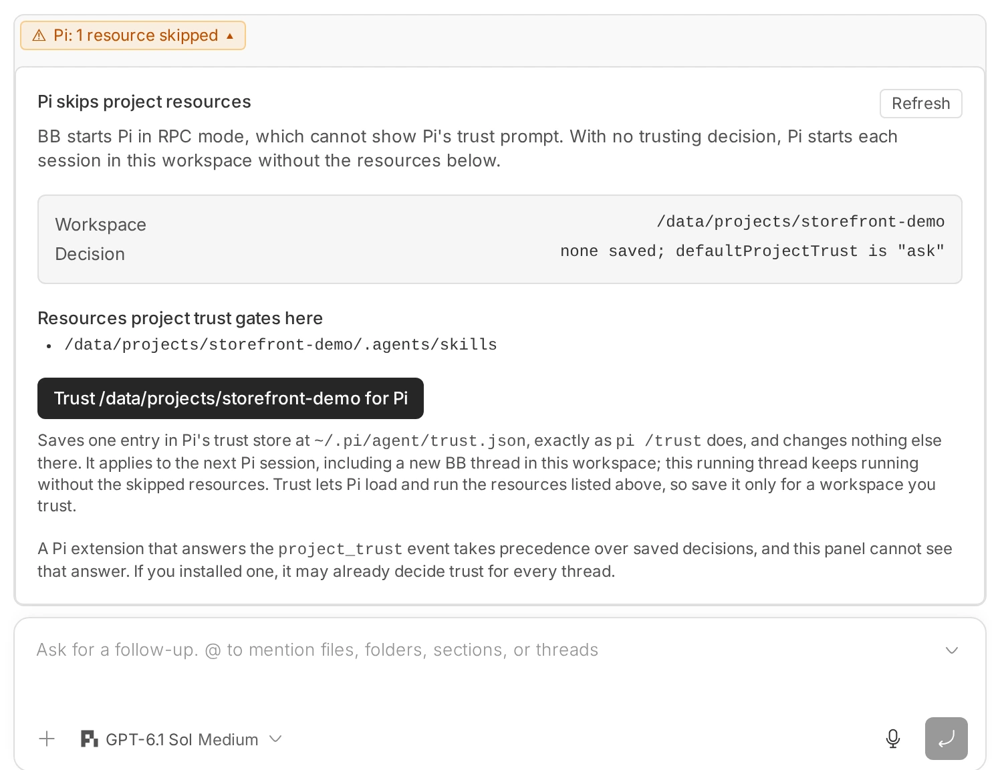
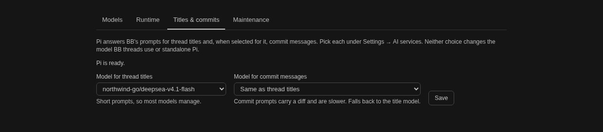

# Pi Extras

A BB plugin for Pi usage, global Pi settings, and Pi-powered thread titles and commit messages.

- **Sessions:** estimated token usage and cost from local Pi transcripts (`~/.pi/agent/sessions`, `~/.bb/pi-bridge-sessions`, and helper traces in `~/.bb/pi-extras-sessions`), broken down by backend, model, project, and day. Adapted from [iamEvanYT/bb-usage-page](https://github.com/iamEvanYT/bb-usage-page) (MIT), vendored under `usage-page/` and scoped to Pi.
- **Subscriptions:** live usage for Pi-managed legacy Codex, OpenCode Go, and Ollama Cloud credentials, with a short-lived cache.
- **Pi settings:** choose standalone Pi defaults and model scope, adjust runtime settings relevant to BB threads, refresh model catalogs, and update Pi extensions.
- **AI services:** to activate Pi-powered thread titles or commit messages, select Pi for each task in BB Settings > AI services. These BB-level selections are separate from the per-task model choices in Pi Extras settings; BB's Automatic setting does not select third-party services.
- **Project trust:** shows a warning segment above the thread's message box (and a sidebar badge) when Pi skipped trust-gated project resources, and saves the per-directory decision Pi's `/trust` would save, only after you press the button.

The Pi Extras plugin adds **Pi Usage** to BB's main sidebar and **Pi** to BB Settings. It is not an agent provider and does not appear in the provider or model pickers. See [THIRD_PARTY_NOTICES.md](../../THIRD_PARTY_NOTICES.md) for attribution.

<details>
<summary>Screenshots</summary>

### Sessions


### Subscriptions


> The Codex usage shown here requires Pi's `openai-codex` credential, offered as the `OpenAI Codex (legacy)` provider. Pi's newer `openai` Sign in with ChatGPT credential supports eligible Responses API inference, but OpenAI rejects it at the ChatGPT usage endpoint, so it cannot fill this card. See [Subscription details](#subscriptions-tab).

### Pi settings



### Model scope



### Runtime settings



### Composer trust warning


### Project trust panel



### Thread titles and commit messages



> To wire up title or commit generation, select Pi for that task in BB Settings > AI services. These are BB-level settings, separate from the model choices above.

</details>

<details>
<summary>Subscription details</summary>

## Subscriptions tab

The host worker reads Pi's `auth.json` from `$PI_CODING_AGENT_DIR/auth.json`, or `~/.pi/agent/auth.json` when that variable is unset. It reads credentials only and never logs, displays, refreshes, or modifies them.

Pi's `openai` sign-in uses Sign in with ChatGPT (SIWC) to authorize eligible Responses API inference. That grant is bound to the `api.openai.com/v1` resource, and its token carries no plan or account claims, so the ChatGPT backend usage endpoint rejects it with a 401 (`rejected_by_access_enforcement`, `no_matching_rule`). Adding scopes does not change this: it is a different token type, not a missing permission. [openai/codex#54219](https://github.com/openai/codex/issues/54219) tracks the gap for token-sharing apps. When this credential is present without a usable Codex credential, the Codex card explains how to get one and links users to ChatGPT settings. The plugin does not send the SIWC token to the Codex usage endpoint.

Ollama Cloud quota polling uses `https://ollama.com/api/balance`, not the activity statistics returned by `/api/usage`. The card converts session, weekly, and monthly remaining percentages into usage bars. When those windows are absent, it derives usage from the included balance and allowance, with renewal from the billing period's end. Purchased credits alone do not define a quota percentage, so purchased-only responses cannot populate the current card.

Codex usage polling therefore requires Pi's `openai-codex` OAuth credential, including its account ID. Pi calls that provider `OpenAI Codex (legacy)` because Sign in with ChatGPT supersedes it, not because OpenAI deprecated it: Pi still maintains it, and `/login` still offers it as the ChatGPT Plus/Pro subscription sign-in. If Pi removes it, Codex's live usage card cannot be populated until OpenAI offers a supported usage API for SIWC tokens. The Codex and Ollama usage endpoints are undocumented and may change. Missing credentials are shown as "not configured"; unreadable or malformed auth data is reported as an error. Codex authentication failures are shown as expired.

</details>

<details>
<summary>Settings details</summary>

## Settings

The Settings entry manages global Pi defaults for provider, model, thinking level, and the model scope. It can also refresh model catalogs and update Pi extensions, with command output shown in the UI. The plugin preserves unrelated Pi settings and never reads or changes credentials.

### Runtime settings

BB picks the model, reasoning level, instructions, and session directory itself when it starts a thread, and it does its own one-message-at-a-time queueing. So the settings that would steer a BB thread from Pi's side are few, and the panel edits only those: automatic summarization of long threads (on or off, the context held back for the reply, and how much recent conversation survives a summary), how long Pi waits on a silent provider, the shell Pi runs agent commands through plus an optional prefix for every command, and Pi's install and analytics reporting.

Most of Pi's global surface is deliberately absent because BB overrides it or because it cannot fire:

- `defaultProvider`, `defaultModel`, `defaultThinkingLevel`, and `enabledModels` are passed as launch arguments, so they only affect standalone `pi` runs.
- Message queueing is BB's own: a steer cancels the running turn and re-prompts one message at a time, so Pi's `steeringMode` and `followUpMode` never apply.
- Prompt-cache warming needs a model that declares a cache lifetime. None of the 57 models in the reference catalog do, so it cannot run.

Every control is tri-state. An empty choice removes the key from `settings.json` and hands the decision back to Pi, whose default is shown as a placeholder rather than written out. Round trips are non-destructive: keys the panel does not model, such as `compaction.modelOverrides`, and unrelated empty objects are left exactly as they were.

### Available models

The default model is a searchable list of the models Pi actually offers, read from the Pi process on the primary machine (`get_available_models` over Pi's RPC mode, with extensions loaded so extension providers appear). The list is cached in the plugin for a minute and is invalidated when you refresh the model catalogs, because Pi itself only re-reads its catalog cache when asked.

The list covers providers with usable authentication, so a saved model can be missing from it because it was retired, because the catalog is stale, or because its provider is not signed in. The panel keeps such a value, marks it as not in the list, and never clears it for you; Pi falls back to one of its per-provider defaults at startup.

### Model scope and exclusions

Pi has no model exclusion setting. `enabledModels` is an allowlist of patterns used for the `Ctrl+P` cycle and for startup selection, and the only way to leave a model out is to leave it out of that allowlist. Patterns may be exact `provider/id` references, fuzzy id or name matches, or globs such as `openai-codex/*`, and they may carry a `:thinking` suffix.

Two consequences shape the panel:

- A `!` prefix is not an exclusion syntax. Pi matches globs without negation support, so `!openai-codex/*` inverts the match and can select nearly every model, while `!openai-codex/gpt-4` never matches anything. The panel flags such patterns instead of writing new ones.
- A non-empty scope overrides `defaultProvider` and `defaultModel` at startup, because Pi starts on the scope's first entry. The panel says so, and keeps the model you picked first in the scope.

The scope editor is driven by the same available-model list. It writes exact `provider/id` references, drops globs you have changed, keeps globs that still cover your selection, keeps patterns that match nothing (Pi warns and skips those, and a model may return), and omits `enabledModels` entirely when every available model is selected, which is how Pi stores "no scope".

### Composer trust warning


### Project trust panel


### Thread titles and commit messages

Select **Pi** independently for thread titles and commit messages under **BB Settings → AI services**. BB's Automatic choice does not select third-party plugins. If Pi is selected for commit messages, its generated subject is cleaned and limited to 72 columns; if generation fails or exceeds the time limit, BB uses its normal fallback.

The **Thread titles** section of Pi settings lets you choose available `provider/id` models for titles and commits, independently of BB's thread model and Pi's global defaults. The commit model defaults to the title model, but can be overridden because commit prompts include a diff and may take longer. An unset title model uses Pi's own default. The service runs on the primary BB machine, where Pi and its credentials must be available. BB creates and cleans both prompts; this plugin passes them to Pi.

</details>

<details>
<summary>Design decisions and implementation notes</summary>

## Design decisions

Rechecked against Pi 1.0.0 on 2026-10-02. BB's `provider-pi` requires a user-installed Pi 0.84.0 or newer and launches `pi` from the host's `PATH` (or `BB_PI_BRIDGE_COMMAND`); its 0.84.0 package pin is a development dependency, not the runtime version. Settings supported by the installed Pi can therefore affect BB threads unless BB overrides them. Nothing here is settled: each entry says what would change the answer. It is written down so that reopening any of these questions starts from the evidence rather than re-deriving it, and so the next reader can tell a deliberate decision from an oversight.

Prefer Pi's own documentation as the durable reference (`packages/coding-agent/docs/settings.md` and `packages/coding-agent/docs/security.md` in the [earendil-works/pi](https://github.com/earendil-works/pi) repository). The line-level references below into the Pi binary and the BB sources are evidence, not an API, and they drift.

### The model defaults configure Pi, not BB

BB launches Pi as a child process and passes the model and reasoning level as launch arguments, so the first four settings the panel edits never steer a BB thread. A live Pi process spawned by BB looks like this:

```sh
pi --mode rpc --session ~/.bb/pi-bridge-sessions/pi_<uuid>.jsonl \
   --session-dir ~/.bb/pi-bridge-sessions \
   --extension /tmp/bb-provider-bridge-provider-pi-*/pi/bb-pi-extension.mjs \
   --append-system-prompt /tmp/.../pi-append-*.md --skill <dir> \
   --model openai-codex/gpt-6-luna --thinking low
```

`defaultProvider`, `defaultModel`, `defaultThinkingLevel`, and `enabledModels` only affect standalone `pi` runs. They stay in the panel because that is a legitimate thing to want to configure from BB, not because they change how a BB thread behaves, and the panel says so where it matters. Reconsider if BB ever stops passing `--model` and `--thinking`.

One more thing the same argument list shows: BB always passes `--session-dir`, so Pi's own `sessionDir` setting cannot move where BB keeps its sessions.

### Helper model selection

Title and commit models are stored in `bb.storage.kv` rather than Pi's `settings.json`, because changing Pi's defaults would also affect standalone Pi runs. A commit model left unset falls back to the title model; an unset title model uses Pi's default. The BB `complete()` API provides no task identifier, so the plugin distinguishes the commit prompt from the title prompt by the commit template's `Shortstat:` and `Files (name-status):` sections. Revisit this if BB adds task-specific AI service declarations.

BB sends a rendered prompt containing instructions followed by `Task:` and the user's text. As one user message it produced a title about the instructions; separating the instructions into Pi's system prompt fixed that. The splitter uses the first `Task:` section marker, since the user's text can contain another. If BB changes this prompt format, the plugin sends the string unsplit. Reconsider if BB passes instructions and task separately.

Pi runs in print mode with `--no-tools --no-session --no-approve --no-context-files --no-skills --no-prompt-templates --thinking off`. **Text mode, not JSON.** JSON mode replays the whole conversation on stdout, and a commit prompt already carries the diff, so the echo runs to roughly three and a half times the prompt. Measured on a 21 KB diff: 77 KB of JSON events against 52 bytes of text, which overran the output cap and made BB fall back to `bb: automated commit` for every large commit. The same commit message answered in 2.0s in text mode. The cost is that Pi stops reporting which model answered, so the log line names the requested model. Reconsider if Pi grows a flag for JSON output without the echo, or a way to report the model it used.

Because text mode returns the model's raw line, this plugin no longer parses or trims the reply; it only strips the trailing newline and rejects an empty answer. BB owns the cleanup for both tasks, stripping quotes and extra lines for a title and clamping a commit subject to 72 columns. If a generated title or commit subject ever looks wrong, BB's sanitizer is the thing to look at first.

BB has a five-second budget for both text tasks; the plugin gives Pi four. Each title or commit helper call writes a named trace (`pi-extras-title-...` or `pi-extras-commit-...`) to `~/.bb/pi-extras-sessions`, separate from BB-managed bridge sessions. The usage scanner includes this directory alongside Pi's other session directories. The shared process runner closes stdin immediately (print mode otherwise waits for EOF), caps output as a runaway guard, and kills the process on timeout or cancellation. The same runner handles Pi's model-list RPC.

Readiness asks Pi for available models with a short timeout, and caches only positive answers for thirty seconds. The settings panel and the AI service use the same check. A model may later become unavailable; BB's ordinary prompt-text fallback covers a failed completion.

### Exposed on purpose

| Setting | Why it is worth a control | Reconsider if |
|---|---|---|
| `compaction.enabled`, `reserveTokens`, `keepRecentTokens` | BB only compacts when asked, so Pi's own thresholds decide what happens once a thread gets long | BB grows a compaction policy of its own |
| `httpIdleTimeoutMs` | A big prompt on a slow reasoning model can sit silent for minutes; this is the most likely cause of a long turn dying | It stops being the cause of any observed failure |
| `shellPath`, `shellCommandPrefix` | Pi passes both straight into its `bash` tool definition at startup, and that tool runs every command in a BB thread | Pi stops building its tool definitions from settings |
| `enableInstallTelemetry`, `enableAnalytics` | Install telemetry affects update reports and provider attribution; the analytics preference is retained for Pi's experimental first-run setup, even though it has no ongoing analytics effect | Pi changes what either setting controls |

### Not exposed

| Setting | Why not | Reconsider if |
|---|---|---|
| `steeringMode`, `followUpMode` | BB does its own queueing. A steer cancels the running turn via `session/cancel` and the bridge drains its queue one prompt at a time, so Pi's internal queue stays empty and the setting has nothing to decide. See `turn/steer` and the queue drain in `packages/provider-bridge-acp/src/bridge/bridge.ts` | BB switches to Pi's native steering instead of cancel-and-re-prompt |
| `cacheWarming` | It only runs for a model that declares a `promptCache` lifetime. No built-in model in Pi 1.0.0's catalog declares one, so the setting still cannot fire with the built-in catalog | A built-in model gains a `promptCache` entry after a catalog refresh, visible by re-querying `get_available_models` |
| `images.blockImages`, `images.autoResize` | Real, and `blockImages` is a genuine footgun: Pi replaces every image in a user message with the text "Image reading is disabled." before it reaches the model. Left out as settings the user does not attach images with. Note `autoResize` only reaches images the agent reads through Pi's own tools, not images attached to a prompt | Screenshots become a routine part of the workflow here |
| `defaultProjectTrust` | The most consequential key in the file, and deliberately left to Pi. A global value silently changes the trust boundary for every repo, so the panel reports the per-directory consequence instead and offers to save one decision | The user asks for a global trust default in BB |
| `hideThinkingBlock` | BB renders Pi's reasoning behind its own `TimelineReasoning` component, so a Pi-side switch adds little | BB stops rendering reasoning blocks |
| `thinkingBudgets` | Reaches BB and works, but is per-level token ceilings that Pi already tunes per model. Left out as not worth the surface | Reasoning cost needs tuning per level |
| `retry.*` | Reaches BB. Left out because Pi's defaults are reasonable and it layers on top of whatever BB does with a failed turn, which was not verified and is a reason for caution | BB documents its own turn-level retry behavior, making the interaction predictable |
| `compaction.modelOverrides`, `retry.provider.*` | Per-model objects and provider-level retries. `compaction.modelOverrides` is preserved untouched on every write, and Pi's reference warns against provider retries | A specific override becomes necessary |

### Settings under evaluation

Pi Extras edits the settings file used by the Pi executable on the host. BB launches the host's installed Pi (minimum 0.84.0), so newer settings may affect BB threads unless BB overrides them. These candidates are not exposed yet; see the [Pi 1.0.0 settings reference](https://github.com/earendil-works/pi/blob/v1.0.0/packages/coding-agent/docs/settings.md).

| Setting | Why evaluate it | What to verify before adding it |
|---|---|---|
| `defaultTools`, `codemode.mode`, `codemode.inlineBudget` | Codemode is registered inactive; `defaultTools` can activate it, and its mode changes whether tools are directly exposed or reached through Codemode. The inline budget trades prompt size against how many tool declarations the model sees. | Test activation and both modes with BB's injected tools. BB reactivates those tools on session start, so confirm the resulting tool exposure and behavior before offering an advanced tools section. |
| `retry.enabled`, `retry.maxRetries`, `retry.baseDelayMs`, `retry.maxAgentDelayMs` | They tune automatic retries when a provider fails. | Verify cancellation, steering, surfaced errors, and retry timing through BB's bridge before exposing controls. Keep provider-level retry settings separate. |
| `websocketConnectTimeoutMs` | It controls WebSocket connection setup, distinct from the existing HTTP idle timeout. | Confirm which supported provider paths use it and whether connection timeouts have been a practical issue; otherwise Pi's default is sufficient. |

`cacheWarming` remains out of scope for the built-in catalog because none of its Pi 1.0.0 models declares a `promptCache` lifetime. `quietStartup` and the TUI settings remain irrelevant to BB threads.

### Project trust, surfaced rather than silently skipped

Pi documents the behavior directly: print, JSON, and RPC modes cannot show the built-in trust prompt, and with no command-line override, extension, or saved decision, `defaultProjectTrust: "always"` loads protected project resources while `"ask"` and `"never"` skip them.

In a BB setup every link in that chain is inert, which is why BB never prompts:

- BB passes neither `--approve` nor `--no-approve`.
- BB's Pi extension handles transport plumbing only; it never handles the `project_trust` event.
- Only Pi's `/trust` in its TUI writes a saved decision, and BB never runs that prompt.

So `ask` means "never" for BB threads and `always` means "every repository, every time", including project `packages` (which install npm packages) and `extensions` (which are executable code). Pi Extras does not expose `defaultProjectTrust` as a setting, because a global switch that silently changes the trust boundary for every repo is not something to flip from a settings page. It reports the per-directory consequence instead:

- The host entry mirrors Pi's own scan (`packages/coding-agent/src/core/trust-manager.ts`): the eight gated entries under `<workspace>/.pi`, plus `.agents/skills` from the workspace up to the filesystem root, excluding the user-level `~/.agents/skills`. A bare `.pi` directory gates nothing, exactly as in Pi.
- It resolves the decision the same way Pi does without an extension: canonical directory keys in `~/.pi/agent/trust.json`, closest parent wins, then `defaultProjectTrust` from user settings. Results are cached for a few seconds and keyed by the trust store's mtime. An unreadable store is reported as unknown rather than as untrusted, and it is never replaced: the panel refuses to save until the store can be read.
- The Trust action carries the machine and canonical path shown on the button. If the thread moves or a symlink retargets before the click lands, the write is rejected instead of trusting a different directory. The panel shows the store path it will write, including when `PI_CODING_AGENT_DIR` overrides it.
- Refresh bypasses the plugin and host caches, so a decision saved by `pi /trust` elsewhere shows up immediately rather than after the 30-second window.
- A segment above the thread's message box reads **Pi: N resources skipped**; expanding it shows the gated paths and, when the workspace is not trusted, offers **Trust <path> for Pi**. The same panel is available as the **Pi project trust** action tab, and a sidebar badge marks the thread in the list. That button appends one canonical `true` entry to `~/.pi/agent/trust.json` under Pi's lock file, preserving every other entry including `null` tombstones, and changes nothing else.
- A Pi thread whose workspace is untrusted also gets a short agent instruction telling it to open its first reply by naming the skipped resources. Agent configuration is synchronous, so the notice uses a check warmed when the thread is created, becomes active, or goes idle; a check that has not finished yet contributes nothing rather than blocking the turn. In a cold, brand-new workspace that can cost the first thread its notice.

Three limits are worth knowing. The composer segment is always available; the sidebar badge additionally needs BB's sidebar metadata experiment and the Organize > Rows > Metadata setting. An installed Pi extension that answers `project_trust` decides before saved decisions do; this panel cannot see that answer, so it can only report what Pi would do without one, and it says so where it matters. And the first-turn notice is best effort: agent configuration is synchronous, so it reads a check warmed when the thread is created, becomes active, or goes idle. In a brand-new workspace, the environment path can appear only after `thread.created`, so the very first thread there can start before the check has an answer and get no notice. The badge and the panel are unaffected, and a later thread in that workspace usually gets the notice, though a long gap can race the observation window again. Closing that gap needs core support, which is tracked as bb#4491.

A saved decision applies to the next Pi session. Clicking the button does not retrofit resources into the running thread; start a new thread, or let the current one finish without them.

### Read-only and out of scope

- **The model list is read from Pi, not configured here.** The panel never writes `models.json` or the catalog, and never touches `auth.json` beyond the credential-free fields the Subscriptions tab reads.
- **Extensions and packages are not managed here.** They are read and updated through Pi's own commands by the existing maintenance actions. Extension-provided providers only appear in the model list because those extensions are loaded, which is why the list is read with extensions enabled.
- **TUI-only settings are out of scope by design**: theme, terminal, markdown rendering, fullscreen (including the Pi 1.0.0 default change), `quietStartup`, editor, autocomplete, tree filters, `doubleEscapeAction`, and `externalEditor`. They do not affect BB threads, and listing them would bury the settings that do.

</details>

## Development

```sh
pnpm install
pnpm test
pnpm run lint
bb plugin install . --yes
```

Tests use fake file reads and fake HTTP responses, and the project-trust fixtures live under the repository's git-ignored `.tmp/`. They make no network calls and never read your Pi credentials.

The trust tests need the sandbox to allow writes to `.pi` directories under `.tmp/`, because Pi's gated layout uses that directory name. Add `"/data/projects/bb-marketplace/.tmp/**/.pi"` to `.pi/sandbox.json` when your global policy denies `**/.pi`.

`pnpm-workspace.yaml` carries one `minimumReleaseAgeExclude` entry for `@get-bb/plugin-sdk@0.6.94`, the SDK that matches the running BB app. Without it, pnpm's dependency-age policy rejects a freshly published SDK. Remove the file once that version is older than the policy cutoff and a plain `pnpm install` passes.
